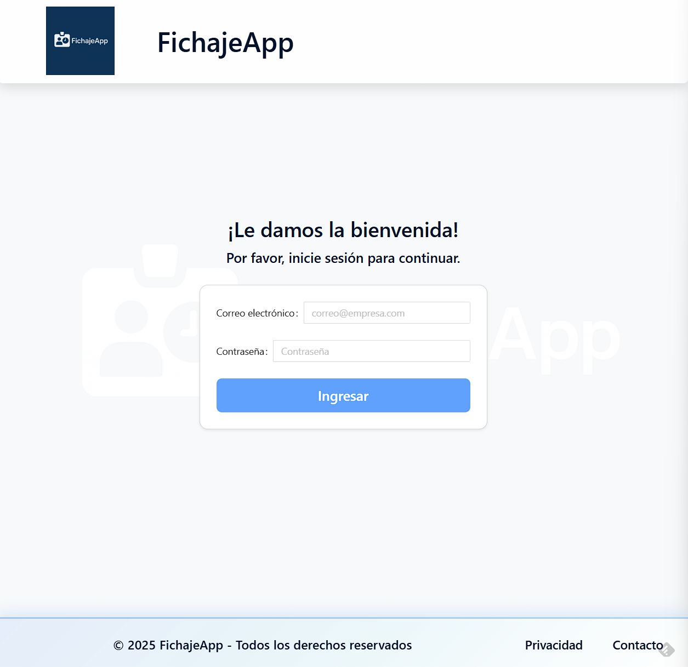
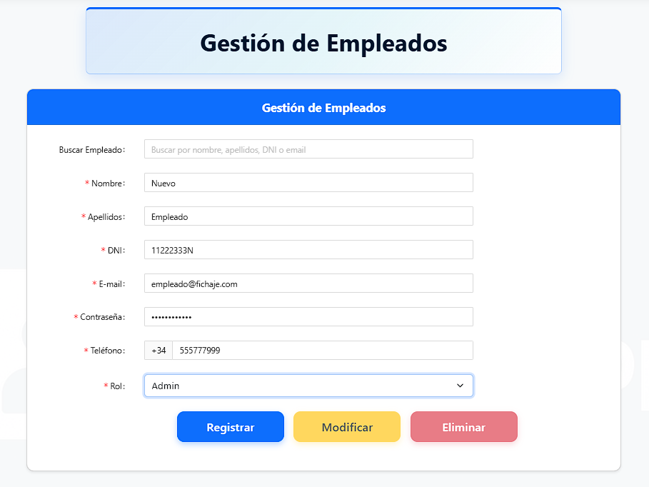
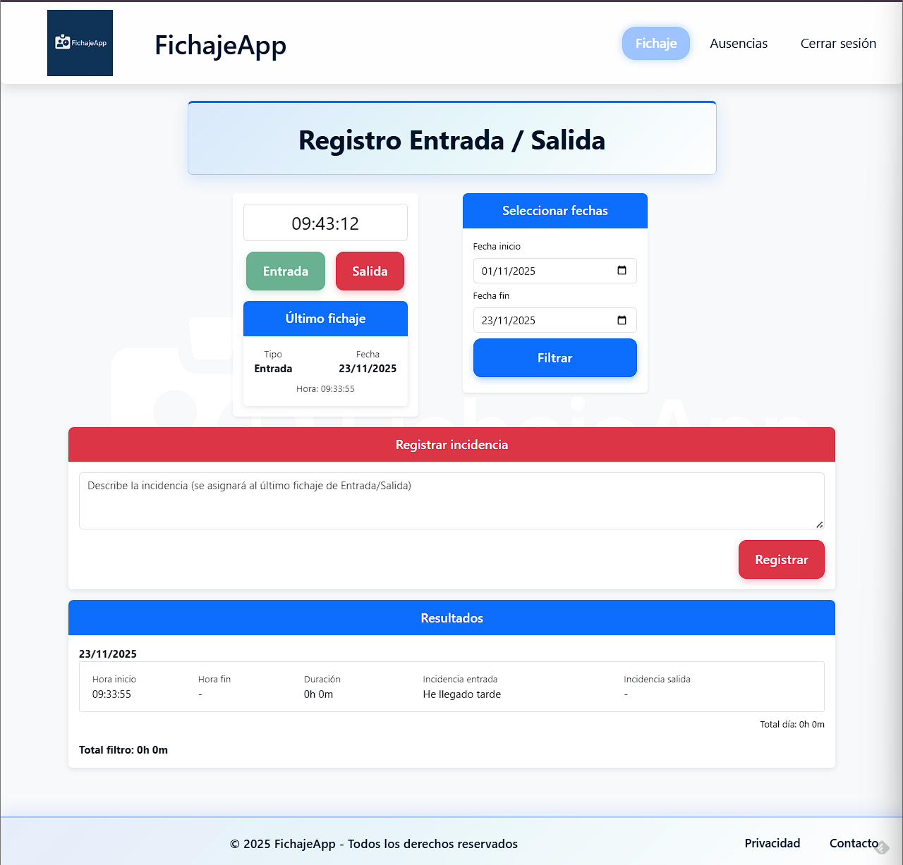
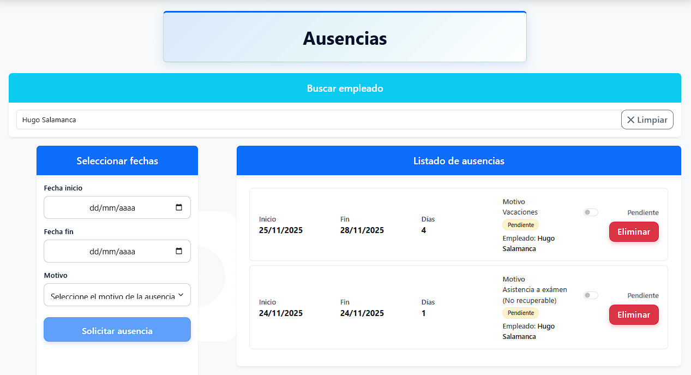

# Proyecto-final-DAM-Jaime-Rodriguez-Rafael
# 🏢 Sistema de Gestión de Recursos Humanos (HR Management System)

## 📄 Descripción del Proyecto

Este proyecto es una **aplicación web Full Stack** desarrollada como Trabajo de Fin de Grado (DAM). El objetivo es digitalizar y optimizar la gestión administrativa de personal en una empresa.

La solución permite la administración centralizada de empleados, el control de fichajes en tiempo real y la gestión de solicitudes de ausencias y vacaciones, integrando un frontend reactivo con una API REST sólida.

---

## 🚀 Funcionalidades Principales

### 👥 Gestión de Personal (CRUD)
* **Altas y Bajas:** Registro de nuevos empleados y procesamiento de bajas.
* **Modificación de Datos:** Edición de información personal y profesional de los trabajadores.

### ⏱️ Control Horario (Fichajes)
* Registro de entradas y salidas de los empleados.
* Histórico de fichajes por trabajador.
* Registro de incidencias de fichajes (olvido de fichaje, entrada más tarde, salida más pronto...).

### 📅 Gestión de Asistencias y Ausencias
* Solicitud de días libres, vacaciones o asistencia al médico por parte del empleado.
* Validación y gestión de estas solicitudes.

---

## 🛠️ Stack Tecnológico

La arquitectura del proyecto sigue el patrón **Cliente-Servidor**:

### **Backend (API REST)**
* **Lenguaje:** C# (.NET Core / .NET 6+).
* **Base de Datos:** PostgreSQL.
* **ORM:** Entity Framework Core (Code First / Database First).
* **Seguridad:** JWT.

### **Frontend (SPA)**
* **Framework:** Angular (TypeScript).
* **Diseño:** HTML5, CSS3, Bootstrap/Material (Ng-Zorro).
* **Comunicación:** Servicios HTTP para consumo de API.

---

## 📸 Capturas de Pantalla

| Login de Usuario | Panel de Gestión | Registro de fichaje | Ausencias |
|:---:|:---:|
|  |  |  | 

---

## ⚙️ Configuración e Instalación

Si deseas ejecutar este proyecto en local:

### Requisitos previos
* Node.js y Angular CLI.
* .NET SDK.
* PostgreSQL instalado y corriendo.

### 1. Base de Datos
Actualiza la cadena de conexión en el archivo `appsettings.json` del Backend con tus credenciales locales de PostgreSQL.

---

### 2. Backend (API)

cd Backend

dotnet restore

dotnet run

---

### 3. Frontend (Cliente)

cd Frontend

npm install

ng serve -o

---

### 4. 👤 Autor
Jaime Rodriguez Rafael.

### 💼 LinkedIn
https://www.linkedin.com/in/jaimerodriguezrafael/

📧 jaime.rodriguez.rafael@gmail.com
